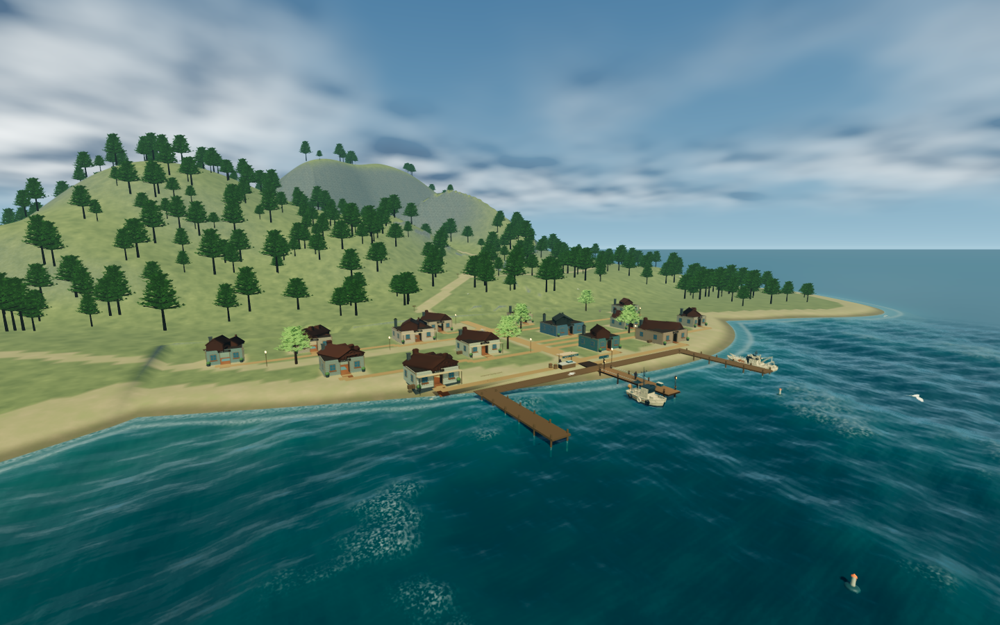
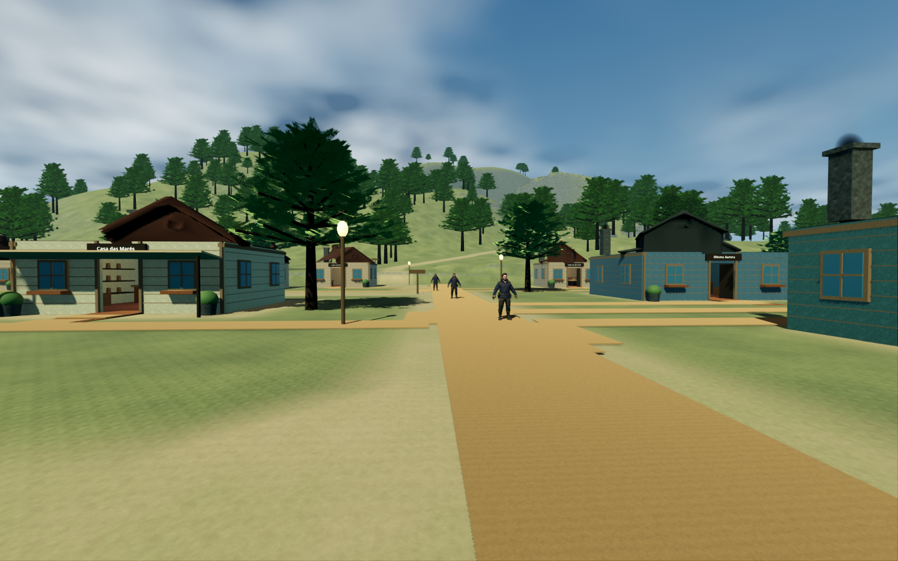
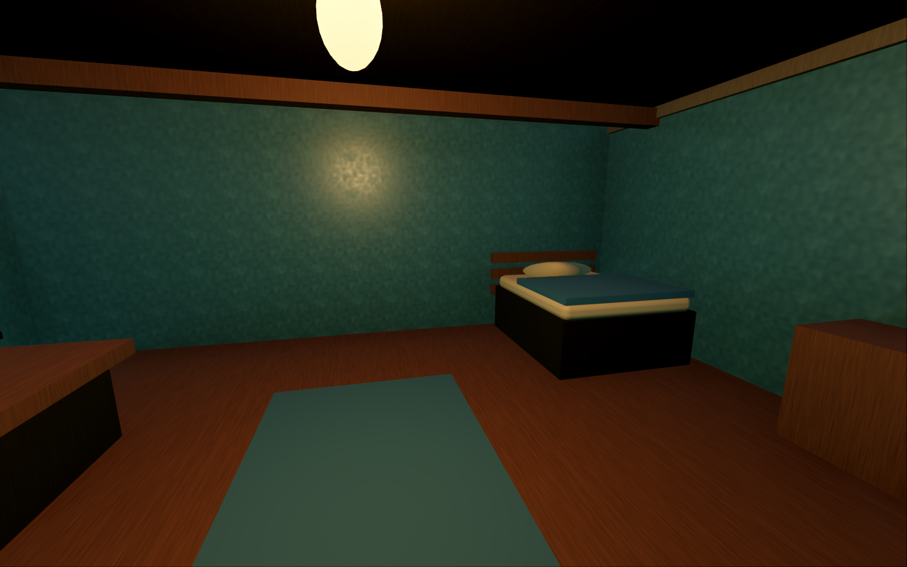
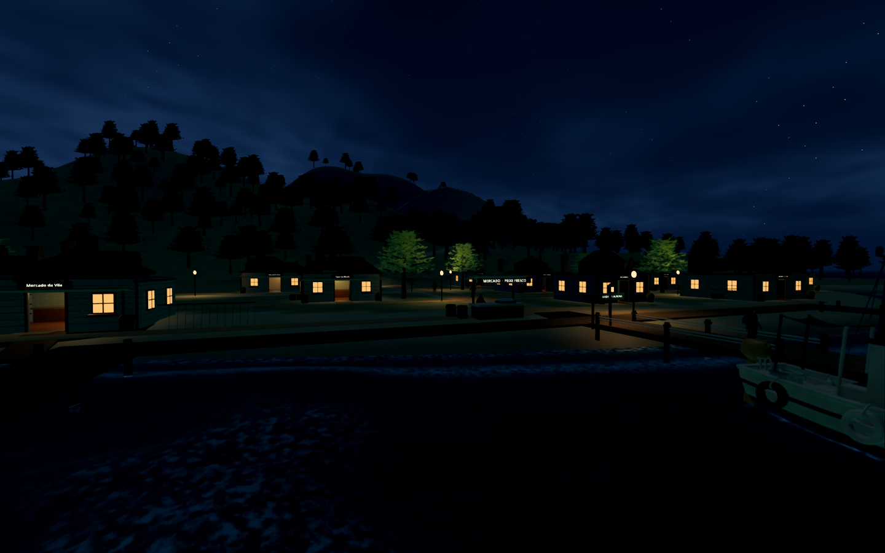
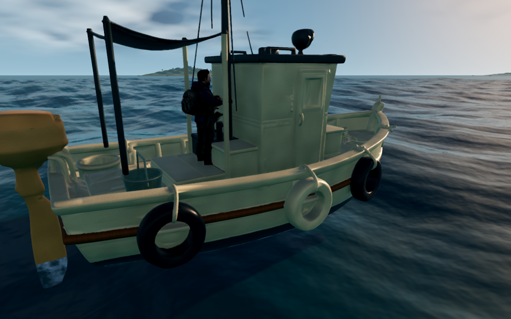
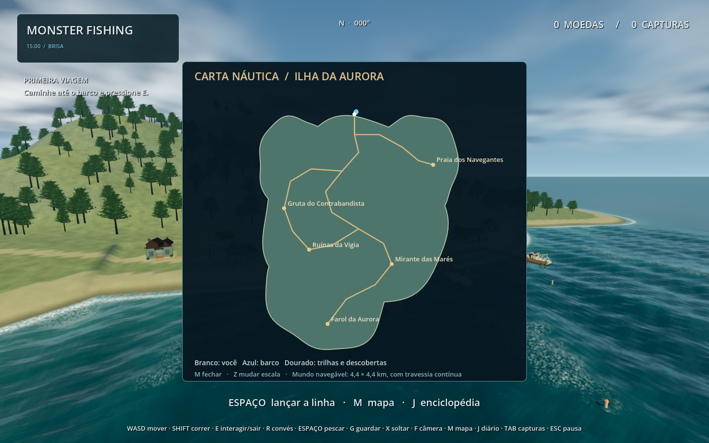
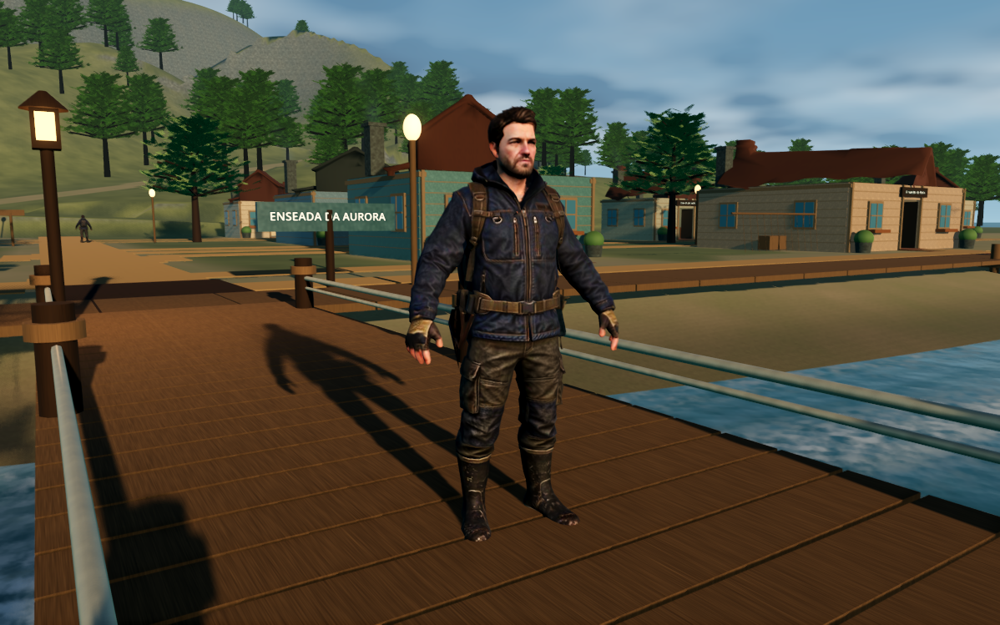
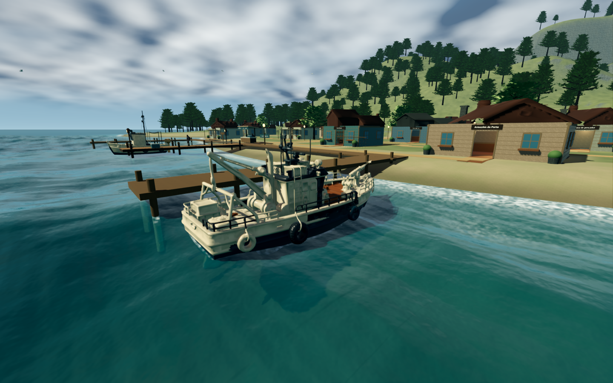
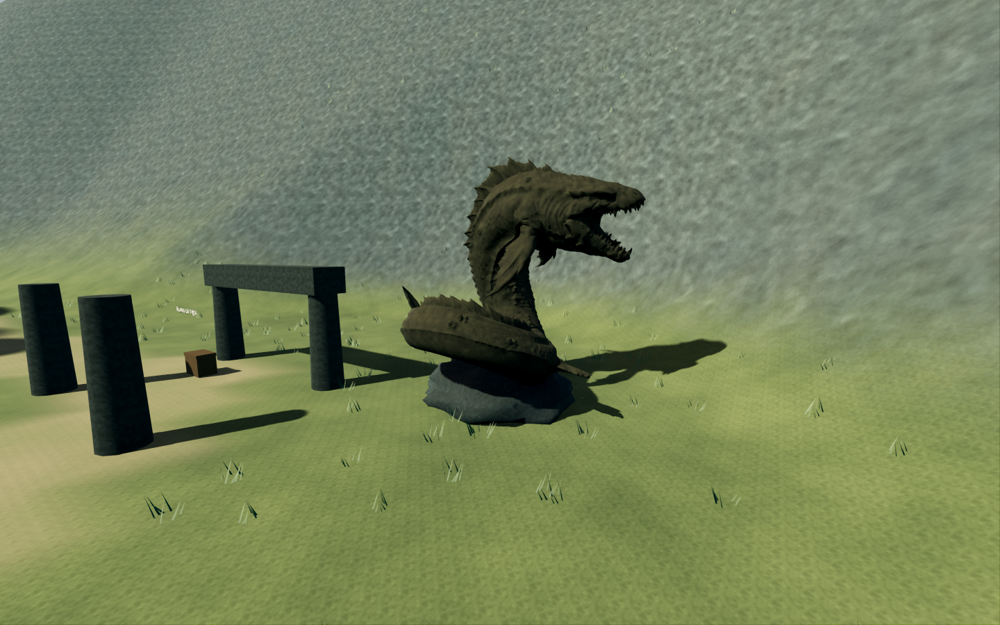

# Arquipélago da Aurora — entrega de 22/10/2026

Esta etapa preserva os controladores e o ciclo de pesca existentes e substitui a costa curta por uma ilha caminhável maior. É a continuação da etapa do oceano registrada no commit 973fc77. O código, os GLBs otimizados e as cenas estão no projeto real; as imagens abaixo são capturas do Godot, sem composição de arte conceitual.

## Ilha inicial e exploração

A ilha combina quatro massas costeiras irregulares em aproximadamente 500 × 570 m. A malha é dividida em componentes de 80 m, com amostras de terreno a cada 2,5 m, normais suaves e colisões geradas da própria superfície. Trilhas têm gradientes caminháveis; terreno, raízes, fundações e rotas compartilham a mesma função de altura. A rota ao farol termina a cerca de 86 m de altitude. Uma volta de barco pelo percurso de validação mede 2,47 km.

A vila tem 14 salas acessíveis, seis serviços, portas abertas, rampas e fundações que chegam ao solo. O cais inicial foi preservado e ligado à nova costa. A passarela portuária, os dois píeres laterais, as ruas e as entradas organizam os edifícios. Há camas, mesas, cadeiras, prateleiras, balcões, luminárias, janelas, redes e caixas junto aos locais de trabalho.

Loja, oficina, mercado, armazém, cabana e pousada usam o inventário/economia reais: iscas consumíveis, bônus de vara/linha/anzol, motor, reparação de casco, venda, armazenamento e descanso. Três moradores percorrem a rua; o comerciante permanece no mercado. Cinco descobertas dão recompensas únicas por sessão: farol, mirante, gruta, ruínas e praia. A gruta é uma passagem sob rochas, não um sistema subterrâneo complexo.

## Navegação, pesca e ambiente

O mundo é um mapa plano de 4,4 × 4,4 km com conexão das bordas opostas. O antigo limite radial foi removido; câmera, água e jogador acompanham a travessia. Não representa uma esfera física. A grade detalhada de água acompanha a câmera, com planos distantes até o horizonte.

É possível sair do barco em qualquer lugar, nadar, chegar à praia, reembarcar ou usar R para caminhar no convés. A cabine é um obstáculo visível, e o convés acompanha o balanço do casco. O barco precisa estar quase parado para lançar. O lançamento verifica água e obstáculos a partir da direção da câmera; funciona na costa, praia, cais e convés, sem depender de um único ponto de pesca.

A captura fica ligada à mão do personagem. G registra e guarda uma única vez no inventário, com transição visual ao balde ou à mochila. X devolve ao mar e registra a descoberta sem acrescentar uma captura vendável. A vara tem cabo, carretel, passadores e ponta usados pela linha real.

O ciclo de 30 minutos percorre dia e noite; o menu permite escolher horário e clima. Sol/lua, estrelas, nuvens, chuva local, relâmpagos, trovão, vento e energia residual são coordenados. Chuva é suprimida sob os interiores; o porto recebe proteção das ondas. A espuma acompanha costa e cristas, com fragmentação temporal. Aves, fumaça e saltos ocasionais de peixes têm limites de quantidade e distância.

## Modelos recebidos

O primeiro modelo integrado e verificado foi o barco pesqueiro. Somente depois foram processados os demais. Fontes e SHA-256 estão em `asset-audit/*.json`; `first-asset-in-game.png` registra a verificação inicial anterior à ampliação da ilha.

| Asset | Triângulos de entrada | Cópia otimizada |
|---|---:|---:|
| Pesqueiro | 1.937.638 | 87.130 |
| Rebocador | 1.966.096 | 68.742 |
| Porto completo | 1.867.436 | 130.697 |
| Dragão | 1.937.946 | 48.504 |
| Cabra | 1.957.950 | 35.242 |
| Personagem, três figuras juntas | 28.358 | 16.380 na figura preparada |

O personagem original não tinha esqueleto ou ações. A figura central foi separada espacialmente e recebeu um rig de 17 ossos e sete clips locais: Idle, Walk, Run, Fish, Hold, Steer e Swim. Há limitações de deformação/poses e espaço para animação artística adicional. Dragão e cabra não receberam um rig fictício: o guardião é observável e não capturável, com respiração simples; a cabra é estática.

O porto original é uma malha composta sem interiores funcionais. Quatro módulos reais de telhado foram extraídos para a vila acessível. A cena completa foi preservada e colocada como maquete na oficina. O rebocador fica atracado com colisão simples; o pesqueiro é pilotável e usa dimensões, marcadores e hidrodinâmica próprios. Texturas originais de personagem/cabra foram preservadas. Os assets sem texturas receberam materiais do projeto. As fontes em Downloads permanecem intactas.

## Arquitetura e desempenho

`archipelago_layout.gd` define costa, altura e trilhas; `archipelago_coast.gdshaderinc` é sua contraparte de GPU. Mudanças costeiras precisam atualizar ambos e passar o contrato CPU/GPU. `island_region.gd`, `harbor_village.gd` e `village_building.gd` separam terreno, assentamento e salas reutilizáveis. Isso permite construir novas regiões sem uma cena monolítica. As três ilhas distantes continuam como bases de expansão; tropical, fria, montanhosa, remota e misteriosa ainda não são regiões completas.

A floresta usa malhas compartilhadas e MultiMesh, três variações próximas, impostores além de 110 m e cobertura de solo local. Volumes simples de copa produzem as sombras da floresta, evitando redesenhar milhares de folhas transparentes em cada cascata. A vegetação evita trilhas, praias, terrenos muito íngremes e clareiras. Construções são agrupadas por material/células espaciais; oclusores respeitam portas, paredes e tetos. Luzes, moradores, aves e partículas são limitados por distância. Todos os chunks de terreno permanecem residentes nesta etapa; ainda não há streaming assíncrono de regiões.

Medição no Ryzen 5 3600 / Radeon RX 580 2048SP, Godot 4.7.2 Forward+, alvo real de 1440×900, MSAA 2× e TAA, VSync limitado a 60 FPS. O arquivo `archipelago-audit/benchmark.json` contém tempos p50/p95/p99, chamadas de desenho e memória. São 600 quadros medidos por vista após aquecimento; não é garantia de desempenho de todo o futuro arquipélago. Capturas curtas incluem compilação de shaders e não substituem esse benchmark.

| Vista | FPS médio | Quadro p95 |
|---|---:|---:|
| Cais | 59,79 | 17,91 ms |
| Vila | 59,79 | 17,87 ms |
| Barco | 59,79 | 18,06 ms |
| Tempestade | 59,79 | 18,13 ms |
| Floresta | 59,79 | 18,07 ms |
| Vila à noite | 59,79 | 18,00 ms |

Memória de vídeo informada pelo Godot: aproximadamente 618 MB. Antes da otimização de sombras e distância da folhagem, a mesma vista da floresta registrava 39,46 FPS. Essa medição é do framebuffer indicado; as capturas da suíte de interface usam a dimensão efetiva da janela, registrada em seu JSON.

## Validação reproduzível

| Suíte | Verificações |
|---|---:|
| Pesca | 24 |
| Terreno e caminho do cais | 15 |
| Integração de controles, pesca e venda | 45 |
| Atracação e câmera | 18 |
| Contrato de água | 8 |
| Oceano sem renderização | 18 |
| Ilha, 14 interiores, trilhas, economia, descobertas e convés | 26 |
| Volta completa de barco e desembarque na praia | 3 |
| Capturas gráficas e interface da pesca | 33 |
| Mesma sequência gráfica em OpenGL | 33 |
| Interface de mapa, loja e pausa | 3 |
| Oceano em Vulkan | 20 |
| Oceano em OpenGL | 20 |

Os relatórios finais são copiados para `archipelago-audit/validation.json`. O contrato gráfico compara 1.280 amostras em cinco condições e locais: erro máximo de altura CPU/GPU de 0,00034 m. Na tempestade, o casco maior segue o plano de flutuação de quatro pontos: atraso máximo de 0,20 m; a diferença em relação à crista apenas no centro chega a 0,651 m. Esse segundo valor não é usado isoladamente como altura de flutuação de todo o casco.

Os testes enviam entradas aos controladores reais para caminhar e navegar. Para inspecionar cada porta, o teste começa na aproximação externa e caminha para dentro; não equivale a uma campanha humana completa por toda a ilha. As trilhas longas e a volta da ilha são percorridas continuamente. As imagens do runtime foram inspecionadas e os problemas de atracação, rampa, vegetação sobre o guardião, rig das mãos e enquadramento do mapa foram corrigidos.

## Limites claros

Ainda não há salvamento entre sessões, missões, cozinha, sobrevivência completa, sonar ou combate com monstros. Materiais e construções misturam assets importados e geometria procedural; o acabamento ainda não é equivalente às imagens conceituais. As animações locais são básicas. A evolução seguinte deve trabalhar o acabamento e ampliar as regiões sobre esta ilha funcional, sem apresentar os espaços distantes como cidades prontas.
