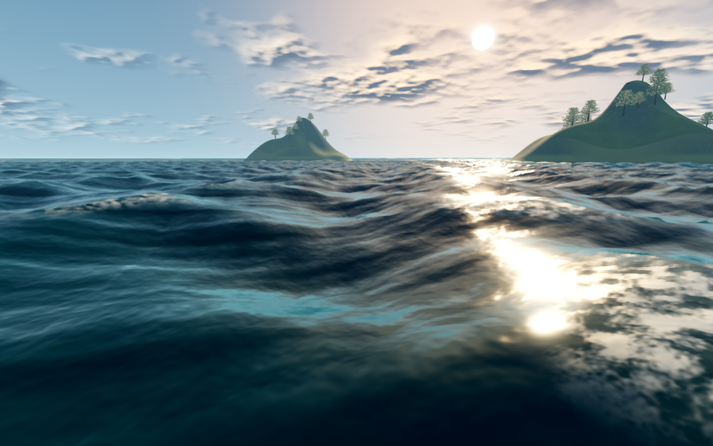
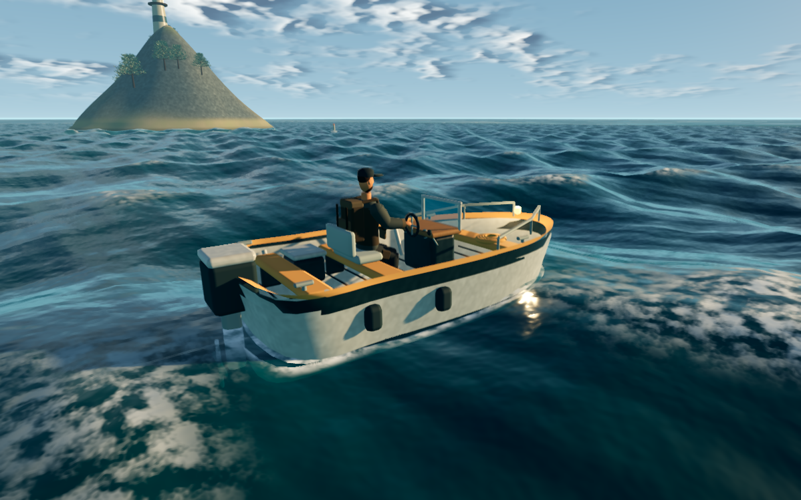
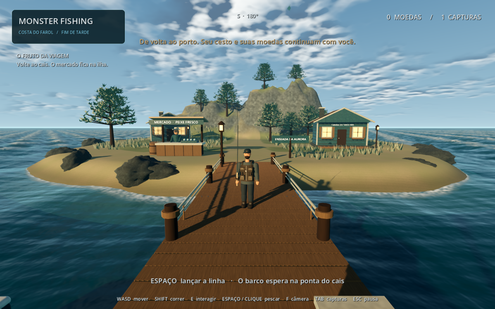
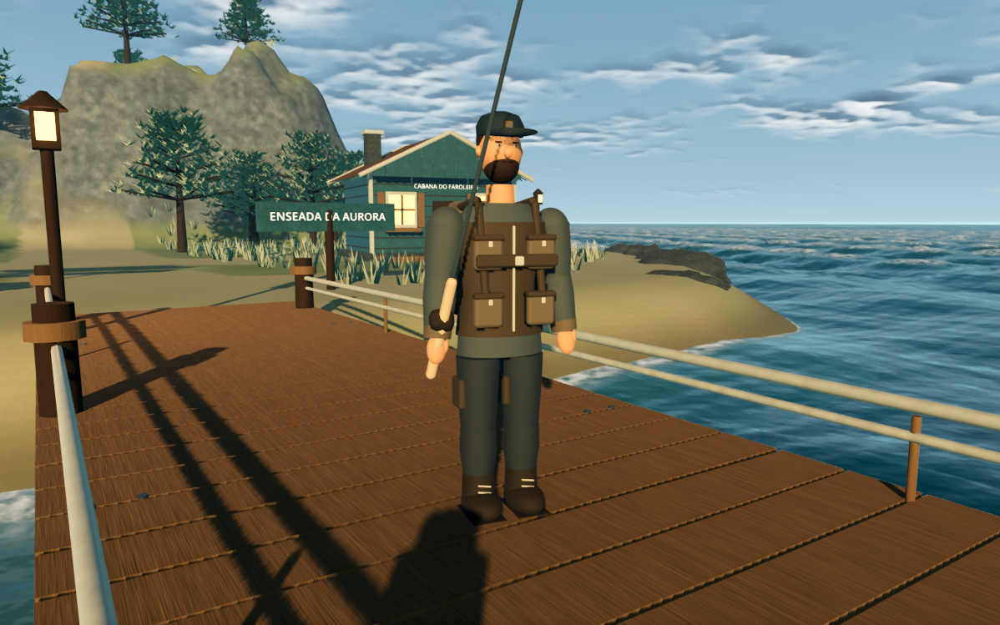
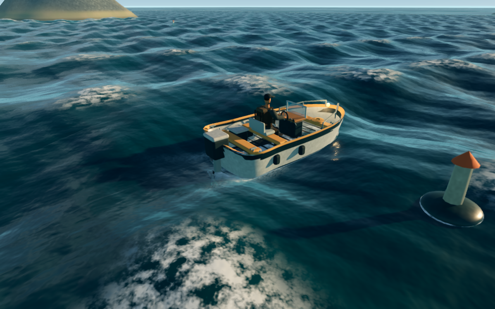

# Atualização visual — 21/10/2026

O projeto existente foi inspecionado antes das alterações. A cena era montada por scripts, com oceano pouco subdividido, cores sólidas, vegetação geométrica e modelos simples. Movimentação, pesca, barco, interface, inventário e objetivos já eram separados em sistemas. Essa separação foi mantida.

## Implementação

1. **Água e luz:** malha próxima de 480 m, ondas em cinco direções/escalas, horizontes mais leves, normais móveis, espuma costeira e de crista, refração e absorção por profundidade. Céu com nuvens, neblina, sombras suaves, sol coerente, ACES e efeitos Forward+.
2. **Enseada:** relevo rochoso atrás da vila, ilhas com elevação, areia úmida, rochas deformadas, pinheiros ramificados, arbustos, relva em MultiMesh, madeira texturizada, ferragens e defensas no cais, revestimento e detalhes construtivos nas casas.
3. **Modelos:** casco interpolado e forro interno, estofamento, instrumentos, amarras e corrimãos. Pescador com proporções revistas, boné, barba, colete de pesca, mochila, botas e articulações adicionais. Barco, boias e isca seguem a altura visual da água; o colisor da embarcação permanece nivelado.
4. **Desempenho:** peças fixas agrupadas por material, vegetação instanciada, texturas de 512 px com mipmaps, horizonte de baixa densidade e perfil OpenGL em `Jogar leve.cmd`.

Nenhuma regra de captura, venda, inventário ou progressão foi substituída. Os testes percorrem novamente o ciclo de sair do cais, navegar, pescar, retornar, desembarcar e vender.

## Capturas do jogo

São imagens da viewport real do Godot, sem pintura ou montagem externa.







Antes da atualização: [cais](before-visual/pier.png) e [vila](before-visual/village.png).

## Reproduzir a validação

`Testar.cmd` executa 108 verificações técnicas. `tests/visual_smoke.gd` percorre a apresentação com 32 verificações e dez capturas, HUD e métricas; `tests/render_benchmark.gd` mede 600 quadros em cada uma de três vistas após aquecimento. Execute os testes gráficos sem `--headless`.

```powershell
& '.\tools\godot\Godot_v4.7.2-stable_win64_console.exe' --path . --audio-driver Dummy --max-fps 60 --script res://tests/visual_smoke.gd -- --visible-visual
& '.\tools\godot\Godot_v4.7.2-stable_win64_console.exe' --path . --audio-driver Dummy --max-fps 60 --script res://tests/render_benchmark.gd
```

Os resultados finais ficam em `visual-performance.json`, `visual-benchmark.json` e `TESTS.md`. A medição usa a RX 580 2048SP deste computador; resolução, VSync e outros aplicativos influenciam os números. O perfil leve não tem SSR, SSAO ou glow.

## Limites e continuidade

Os três painéis posteriores orientaram a luz dourada, costa rochosa, equipamento do pescador, cores da interface e acabamento do barco. Esta entrega aplica essa direção à fase jogável existente; os painéis também ilustram sistemas futuros (criaturas, sonar, outras regiões, interiores e clima) que não foram adicionados nesta atualização visual.

O resultado usa shaders e geometria originais. Ainda não tem o acabamento fotorrealista dos painéis: modelos e animações são procedurais; não há arrebentação com partículas, fluidos simulados ou reflexos fora da tela. O progresso permanece em memória durante a sessão, como na fase anterior.

Implementação de profundidade conferida com a [documentação oficial de reconstrução de posição](https://github.com/godotengine/godot-docs/blob/master/tutorials/shaders/advanced_postprocessing.rst) e o [artigo de reverse Z do Godot](https://godotengine.org/article/introducing-reverse-z/). Recursos de iluminação conferidos na [referência de Environment](https://github.com/godotengine/godot-docs/blob/master/classes/class_environment.rst).
